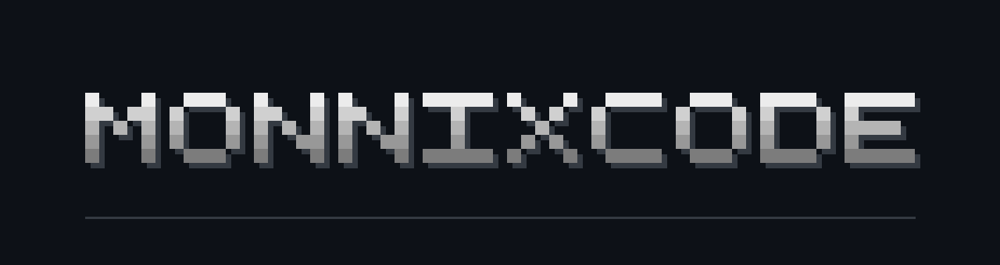

# MONNIXCODE Workspace

MONNIXCODE Workspace เป็นหน้าเว็บแบบ standalone สำหรับเปิดบน Browser หรือรันจาก Termux ด้วย Python HTTP server โดยรวม Terminal UI, GitHub public clone และ Mobile File Workspace ไว้ในหน้าเดียว



## ความสามารถรุ่นปัจจุบัน

- Header แบบ pixel-art ตามภาพ MONNIXCODE ที่แนบมา
- Terminal UI แบบ responsive สำหรับมือถือและ Desktop
- ธีม Classic, Cyberpunk และ Matrix
- `git clone <public GitHub URL>` ใน Browser เพื่อโหลดไฟล์ข้อความขนาดเล็กของ repository สาธารณะมาไว้ใน workspace
- เลือกไฟล์หลายไฟล์จากมือถือ
- เลือกทั้งโฟลเดอร์จากมือถือด้วย folder picker ที่ Browser รองรับ
- Drag-and-drop ไฟล์บน Desktop หรือ Browser ที่รองรับ
- File browser, preview ไฟล์ข้อความ และสถานะขนาดไฟล์
- คำสั่งดาวน์โหลด/เปิดไฟล์ผ่าน Browser ตามสิทธิ์ของ Browser
- เก็บ workspace ชั่วคราวใน session ของหน้าเว็บโดยไม่อัปโหลดอัตโนมัติ
- มี Termux source code แยกใน [`termux-source/`](termux-source/)

## Public online

เมื่อเปิด GitHub Pages สำเร็จ ให้เปิด:

<https://monnixcode.github.io/MONNIXCODE-HTML-/>

หาก URL ยังตอบ `404` ให้เข้า **Settings → Pages** แล้วเลือก:

```text
Source: Deploy from a branch
Branch: main
Folder: /(root)
```

จากนั้นกด **Save** และรอการ deploy สักครู่

## Android Kotlin application

ในโฟลเดอร์ [`android-app/`](android-app/) มี Android project ภาษา Kotlin สำหรับ Android 15, 16 และ 17+:

- `minSdk = 35` (Android 15)
- `compileSdk = 36` และ `targetSdk = 36` (รันได้บน Android 15, 16, 17+; Android 16 เป็น API 36)
- ใช้ WebView บรรจุ Web Workspace เดิม
- ใช้ Android file chooser สำหรับเลือกไฟล์จากมือถือ
- มี `BootstrapInstaller` และ bootstrap runtime contract แยกไว้ใน `app/src/main/assets/bootstrap/`
- มี GitHub Actions ที่ `.github/workflows/android-release.yml`

Build APK ทดสอบในเครื่อง:

```sh
cd android-app
./gradlew assembleDebug
```

สร้าง GitHub Release พร้อม APK:

```sh
git add android-app .github/workflows/android-release.yml
git commit -m "Prepare Android app release"
git push origin main
git tag v1.0.0
git push origin v1.0.0
```

Workflow จะ build debug/release APK, อัปโหลดเป็น artifact และแนบ APK เข้า Release ของ tag โดยอัตโนมัติ อ่านรายละเอียดที่ [`android-app/README.md`](android-app/README.md)

> Bootstrap ใน project ตอนนี้เป็น runtime contract และ installer layout ที่ตรวจสอบได้ ไม่ใช่การสร้าง binary shell ปลอม หากต้องการ Linux shell เต็มรูปแบบ ต้องเติม bootstrap archive ที่ build จาก `termux-packages` ให้ตรงกับ ABI พร้อม checksum และ license ก่อน

## ติดตั้งและรันบน Termux

```sh
pkg update && pkg upgrade -y
pkg install git python -y
git clone https://github.com/monnixcode/MONNIXCODE-HTML-.git
cd MONNIXCODE-HTML-
chmod +x run.sh
./run.sh
```

เปิด Browser บนมือถือที่:

```text
http://127.0.0.1:8080
```

ใช้ port อื่นได้:

```sh
./run.sh 3000
```

อ่านคู่มือเต็มที่ [TERMUX-GUIDE.md](TERMUX-GUIDE.md)

## การใช้งาน GitHub clone ในหน้าเว็บ

พิมพ์ใน Terminal:

```sh
git clone https://github.com/monnixcode/MONNIXCODE-HTML-.git
```

หรือใส่ URL ในกล่อง **GitHub public clone** แล้วกด `Clone`

ระบบจะเรียก GitHub API และโหลดเฉพาะไฟล์ข้อความ/ซอร์สขนาดไม่เกิน 200 KB ต่อไฟล์ สูงสุด 80 ไฟล์ มาไว้ใน `Files / Folders` เพื่อ preview ใน Browser เหมาะสำหรับดู source, README และไฟล์ config แบบสาธารณะ

คำสั่งที่เกี่ยวข้อง:

```sh
git help
git status
ls
open README.md
```

> นี่เป็น browser-compatible clone สำหรับอ่านไฟล์ ไม่ใช่ Git client เต็มรูปแบบ และไม่รองรับ private repository, push, commit, branch, merge หรือการรันคำสั่งบนเครื่อง

## การใช้ไฟล์และโฟลเดอร์มือถือ

1. เปิดแท็บ `Files / Folders`
2. กด `Choose files` เพื่อเลือกหลายไฟล์
3. กด `Choose folder` เพื่อเลือกทั้งโฟลเดอร์ หาก Browser รองรับ
4. หรือวางไฟล์ลงในพื้นที่ `Drop files here`
5. แตะชื่อไฟล์เพื่อ preview

Browser จะขอสิทธิ์เฉพาะรายการที่ผู้ใช้เลือก ไม่สามารถเปิดอ่านทุกโฟลเดอร์ในมือถือโดยอัตโนมัติ และไฟล์จะอยู่เฉพาะใน session ของ Browser

## คำสั่งใน Terminal

```sh
help
clear
pwd
whoami
date
uname
neofetch
echo hello
ls
git clone <public GitHub URL>
git status
git help
nix help
nix up
nix in git curl
nix rm git
nix ls
```

## ข้อจำกัดสำคัญ

หน้าเว็บไม่สามารถรัน Linux shell จริงหรือทำงานกับไฟล์ทั้งหมดในมือถือโดยไม่มีการเลือกจากผู้ใช้ได้ เนื่องจากข้อจำกัดความปลอดภัยของ Browser ดังนั้นคำสั่งต่อไปนี้ต้องรันในแอป Termux จริง:

```sh
apt
pkg
sudo
bash
python
node
make
git clone <any repository>
git commit
git push
```

สำหรับการใช้คำสั่งได้เต็มรูปแบบ ให้เปิด Termux แล้วใช้ source จาก repository นี้:

```sh
cd ~
git clone https://github.com/monnixcode/MONNIXCODE-HTML-.git
cd MONNIXCODE-HTML-
```

จากนั้นใช้คำสั่ง Linux จริงใน Termux โดยตรง ไม่ใช่ช่อง Terminal ใน Browser

## โครงสร้างไฟล์

- `index.html` — Web Terminal + GitHub clone + Mobile File Workspace
- `assets/monnixcode-header.png` — pixel-art header จากภาพที่ผู้ใช้แนบ
- `run.sh` — เปิด Python HTTP server
- `TERMUX-GUIDE.md` — คู่มือติดตั้งและใช้งาน Termux
- `TERMUX-SOURCE.md` — คำอธิบายการรวม Termux source
- `termux-source/` — Android/Termux source code แยกชุด
- `.github/workflows/pages.yml` — workflow สำหรับ GitHub Pages

## License

MONNIXCODE HTML edition ใช้ GPLv3 ตามไฟล์ [LICENSE.md](LICENSE.md) โปรดรักษา license และ notices ของ source ใน `termux-source/` ตาม [termux-source/LICENSE.md](termux-source/LICENSE.md)
